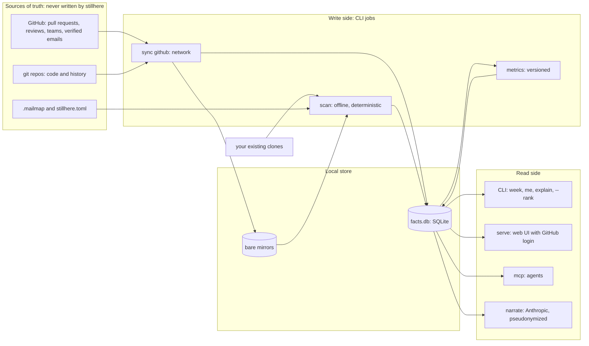

# Architecture

Status: draft v2 · 2026-10-14 · decisions in [adr/](adr/), implementation contracts in [spec/](spec/)

## Shape

stillhere is one Go binary. CLI jobs write facts; the CLI, the web server, and the MCP server read them. Only `sync` touches the network for data. `narrate` calls Anthropic, and only when asked.

The web server (`serve`, M3) and `narrate` (M4) are not built yet: what this page says about them, and about what they bring (sign-in, leads, sessions, the audit log, narrations), is the design they will follow.

This is CQRS in its simplest form: jobs that write facts are separate from the services that read them. The read side never mutates facts, so a bug in the web server cannot corrupt measurements.

## Bounded contexts

| Context | Vocabulary | Facts it writes | It is not |
|---|---|---|---|
| Sources | repo, group, mirror, default branch | repos, heads | A forge inventory |
| History | commit, landing, trailer | commits, commit_parents, commit_coauthors (the Co-authored-by trailers), landings, landing_commits, commit_files, reverts; and who wrote each commit of the clone's other refs, and when (ref_commits, ref_commit_coauthors, wave 10), which only activity reads | Ownership |
| Authorship | line owner, majority owner | line_owners (per run) | Activity |
| Forge | pull request, review, team | forge_repos, forge_watermarks, forge_pull_requests, forge_pull_labels, forge_reviews (inline comments counted, not kept), forge_pull_commits; per run, what it read: forge_run_watermarks and forge_run_repos (the join), and the forge_snapshot_* copy of its repositories and pull requests, with the older pull requests' commit-to-account links (forge_snapshot_links, #103) ([ADR 0011](adr/0011-a-run-keeps-the-github-facts-it-read.md)) | Git facts |
| Identity | person, alias, login link | Nothing: a run's people, and which person a GitHub login is, are derived each time the run is read (package `identity`) | A people database |
| Metrics | metric@version, scope, window | metric_values, rank_intervals | Facts |
| Presentation | page, highlight, tool | Nothing (read-only) | Measurement |
| Narration (M4) | comment | narrations | A measurement |

A context's facts are written by its own collector only. The Forge context translates GitHub's model into our facts through an anti-corruption layer, so GitHub field names never leak into metrics.

## Data ownership

| Data | System of record | Writes it | Reads it | How it crosses into stillhere | Consistency readers need |
|---|---|---|---|---|---|
| Code, history, default branch | Each git repo (GitHub is origin) | Developers, via git | `scan`, through the git CLI | `sync` fetches mirrors; or your own clones as they are | Snapshot at the recorded HEAD SHAs |
| Pull requests, reviews, comments, labels | GitHub | People on GitHub | `sync` | GraphQL, newest update first, in passes bounded by the 365-day window or the last completed pass's start on GitHub's clock; upsert by node ID; each pass checked against GitHub's search count ([ADR 0013](adr/0013-sync-reads-bounded-passes-and-checks-the-replica.md)) | Complete within the window, as of the last sync, shown on every page; a caveat where the check found pull requests missing |
| Which GitHub account an author email belongs to | GitHub (the account that verified the email, or whose noreply address it is) | The user, by verifying the email | `sync` | GraphQL, one commit per email of the mirror's history, asked once and kept in facts.db ([ADR 0013](adr/0013-sync-reads-bounded-passes-and-checks-the-replica.md)); identity reads it as evidence and suggests, `.mailmap` decides | As of the sync that first asked; an email verified later stays unlinked until facts.db is made anew |
| Who is a lead | A GitHub org team | Org admins | `serve` (M3), at login | The user's token at sign-in, re-checked hourly | Fresh within an hour |
| A user's verified emails | GitHub | The user | `serve` (M3), at login | The user's token at sign-in; not stored | Fresh at sign-in |
| Email aliases | `.mailmap` in each repo, plus an org mailmap file | Users, in reviewed files | git itself (`-c mailmap.file=`) | Applied by git during scan | Same run |
| GitHub login ↔ email | GitHub commit-author associations | GitHub | `sync`, then every reader of a run | `sync` copies each pull request's commits with the login GitHub resolved each author's email to; a reader links a login to the person whose mailmapped commits those are, and stores no link | As of the GitHub data the run kept |
| Noise rules, bot and AI patterns, thresholds | `stillhere.toml` (or the packaged default) | The user | Collectors and metrics | File; SHA-256 recorded per run | Same run |
| Metric definitions | stillhere source, versioned | Contributors, through review | Metrics | Code | Cited per value |
| Facts, metric values, narrations | facts.db (derived, disposable) | stillhere jobs | All read-side adapters | Local file | Readers see published runs only: complete or partial, never one still being written |

stillhere creates no second owner of any fact. Identity in particular stays with `.mailmap` (aliases) and GitHub (logins, verified emails). There is no hand-maintained people table that would drift from either.

## Commands

| Side | Command | Network | Writes |
|---|---|---|---|
| Write | `sync github` | GitHub API, git fetch | mirrors (with a commit-graph each), forge facts; an unwritable facts.db is refused before any network call |
| Write | `scan` (later `backfill ownership`) | None | a run: history, authorship facts, metric values; an unwritable facts.db is refused before any git work |
| Analysis | `week` | None | Nothing: it prints what landed |
| Analysis | `policy` | None | Nothing: it prints the policy `week` and `scan` would use, as a complete file to edit |
| Read | `report`, `me`, `explain`, `who-knows`, `identities`, `validate`, `label` | None | Nothing, except migrating a facts.db an older stillhere wrote; they never create one, so a mistyped `--db` is a usage error that names the path. `label` appends the user's labels to the labels file (beside facts.db unless `--labels` names another, 0600), user-owned input that `validate` reads ([validation.md](validation.md)) |
| Read | `metrics` | None | Nothing |
| Read | `serve` | GitHub at sign-in | Sessions, audit log |
| Read | `mcp` | None (stdio) | Nothing: it opens facts.db read-only |
| Read | `narrate` | Anthropic API | narrations |

## Ports and adapters

| Port | v1 adapter | Later |
|---|---|---|
| GitRunner | `git` subprocess with an *analysis* profile (offline, hardened) and a *sync* profile (network, credentials supplied per command) | In-process git if blame time is ever dominated by process start |
| ForgeSource | GitHub's GraphQL API for repositories, pull requests and reviews, and git over HTTPS for the managed mirrors | GitLab |
| FactStore | SQLite via `modernc.org/sqlite` (no CGO, so the binary stays static) | Postgres for a large team server |
| Authenticator (M3) | GitHub App user sign-in | Trusted identity headers from a proxy (oauth2-proxy, Cloudflare Access) |
| Narrator (M4) | Anthropic Messages API via `anthropic-sdk-go` | |
| Inbound | CLI, MCP server (official Go SDK); in M3, an HTTP server (`net/http`, `html/template`, `embed`) | Remote MCP over HTTP, with auth |

The core (classification, metrics, ranking) imports no adapter package: no `os/exec`, no `net/http`, no SQL driver. depguard enforces this in CI. Tests run the core against facts directly, and run adapters against real git, recorded GitHub responses, and a temporary SQLite file. The package map, the dependency rule and the signatures between packages are in [spec/codebase.md](spec/codebase.md).

## Storage

`facts.db` holds runs. Each run is a snapshot (details and the Go contracts in [spec/codebase.md](spec/codebase.md#run-model)):

- **runs**: run id, `--now`, tool version, policy hash, the HEAD of every repo, the forge sync watermark, and a status. A run's HEAD is the repo as it stood at `--now`, the newest first-parent commit of its default branch committed before then, because every window is measured back from `--now` and none extends past it; a newer head the clone fetched is named in a `head-after-now` caveat, never read, and landings dated after `--now` that a backdated commit leaves below the commit read are counted in a `dated-after-now` caveat. A run is written as `running` and flips to `complete` (or `partial`) after its last row; readers select only complete and partial runs, so nobody sees half a run. WAL mode lets reads continue while a run writes.
- **Git-derived facts are per run**: commits, landings, the landing map, file changes, reverts, path classes, line owners, and the commits of the clone's other refs that the run's HEAD does not hold (who and when only). The mailmap and the policy can change between runs, and every number in a run must come from one HEAD set, one policy and one mailmap. A force-push simply shows up in the next run's history. The cost is repeated rows across runs, bounded by retention.
- **line_owners** are aggregated as (repo, path, commit, author, non-blank lines). That is roughly one row per file per contributing commit: about 250,000 rows for a 50,000-file organization.
- **Forge facts** replicate GitHub, upserted by node id with a watermark per repo, in a replica that outlives runs. Each run keeps the part it read, as it keeps its git facts: its watermarks, the join of its repositories to the forge's, and a copy of their pull requests, which its readers compute over instead of the replica, so a later sync moves no stored run ([ADR 0011](adr/0011-a-run-keeps-the-github-facts-it-read.md)).
- **Retention**: when a run finishes, the newest 8 runs plus the newest run of each of the 12 most recent months that have one, per kind (restic's `--keep-last 8 --keep-monthly 12`); configurable later.
- **metric_values** and **rank_intervals** carry `metric@version`, scope, window and run id, so a new metric version can be computed over old facts and shown next to the old one.

`report.json` is an export of one run, the published language for tools that do not want SQL. Its shape, `stillhere.report/v1`, is in [spec/report-json.md](spec/report-json.md).

## Reliability

- **Bulkheads**: one repo, or one repo's GitHub sync, failing is recorded on that repo and the run continues. A run with failures is marked `partial`, and pages say so.
- **Idempotent, resumable sync**: upserts keyed by GitHub node ID, and a watermark per repo that only a completed pass moves, to the time it began on GitHub's clock, so a crash, a rate limit or an interrupt costs a re-read of a bounded range and never leaves a hole; a count of the window's pull requests on GitHub and in the replica reconciles the two after every pass, and the same sync repairs a shortfall ([ADR 0013](adr/0013-sync-reads-bounded-passes-and-checks-the-replica.md)). GraphQL allows 5,000 points per hour; at most three requests are in flight, one per repository, and a rate limit holds them all, to stay under GitHub's secondary limits.
- **Determinism**: an explicit `--now`, seeded bootstrap, stable sort orders. A CI test scans the fixtures twice and compares the bytes, once the wall-clock `timings` are removed.
- **One version floor, git 2.45**: it brings `GIT_NO_LAZY_FETCH` (a partial clone's missing blobs read as missing, not fetched) and also covers `check-attr --source` (2.40, needed to read attributes at the scanned revision and in bare mirrors) and `--diff-merges` (2.31). Older git exits with a usage error. See [spec/git-invocation.md](spec/git-invocation.md#version-floors).
- **Oracles**: synthetic fixture repos with hand-derived expected values for every metric version ([testdata/fixture/SPEC.md](../testdata/fixture/SPEC.md)), plus recorded GitHub API responses for sync.
- **Budgets**: a cold scan of 100 repos and 50,000 files in under 15 minutes on 8 cores; `week` in under 60 seconds; web pages under 300 ms at p95.

## Security and privacy

| Threat | Mitigation |
|---|---|
| A token leaks into a remote URL, log, report or page | Credentials are supplied per git command, never written to config or URLs. Userinfo is scrubbed from every stored or printed URL. A test greps every output for a planted token. |
| A hostile repo runs code when git is invoked | Hooks, fsmonitor, external diff and textconv are disabled; analysis never runs clean or smudge filters, because it never moves content between a work tree and the object store; global config is ignored, and analysis refuses every network transport ([git-invocation.md](spec/git-invocation.md#analysis-commands-offline)). Residual risk: a repo-local `gpg.program`, which runs only for a command that verifies signatures, and no collector does. stillhere is not a sandbox for untrusted repos. |
| Script injection through author names | Names are treated as untrusted; the fixture includes `Frank & Sons`. Text output shows control and format characters escaped, so a name carries no terminal escape or bidirectional override, and Markdown output escapes every character that Markdown or inline HTML reads as syntax. In M3, `html/template` escapes the web UI by context (text, attribute, URL, JavaScript). |
| Session theft or forged sign-in (M3) | GitHub App sign-in with a state parameter; signed `HttpOnly`, `Secure`, `SameSite=Lax` cookies with a short lifetime; TLS required in front of the server. |
| Someone sees ranks they should not | Until M3, the file is the boundary: facts.db is created 0600 in a 0700 directory, and only local commands read it, so whoever can read it sees every rank and every person's page, AI-assisted share included (`me --email` takes anyone's address). In M3, `serve` denies by default: leads (a named GitHub team) see ranks; each person sees their own page; org members see highlights and code-area views. An audit log records who opened ranked views (M3, not built). |
| Personal data exposure | Emails are never rendered. `facts.db` and mirrors are created with mode 0600/0700 and documented as sensitive. Retention limits apply. |
| The narrator leaks identities or code (M4) | Placeholders replace people (names restored locally); no emails, source, commit subjects or absolute paths are sent; every number in the reply must appear in the payload. |
| An agent reads source it should not | MCP is local stdio; diffs are exposed only with `--allow-source`. |

The GitHub App (M3) asks for read-only permissions: repository contents, pull requests and metadata; organization members; account email addresses. An org admin installs the app once. Until then, `sync github` reads GitHub with the user's own token.

## Deployment

- **Laptop**: from the first release, `brew install --cask ihaveasegway/tap/stillhere` or a release archive; until then, `go install` or a build from a checkout ([README](../README.md#install)). Point it at your clones or let `sync github` manage mirrors.
- **Team server** (M3): one container image (the stillhere binary plus git 2.45 or newer) with a volume for mirrors and `facts.db`, GitHub App credentials in the environment, and TLS terminated in front. How refresh is triggered is open decision 4 in [product.md](product.md#open-decisions).
- **Later**: a scheduled GitHub Action that runs `sync` and `scan` and uploads the run.

## Patterns and further reading

- CQRS (write jobs and read services): Martin Fowler, "CQRS" (bliki).
- Ports and adapters: Alistair Cockburn, "Hexagonal Architecture".
- Bounded context, anti-corruption layer, published language: Eric Evans, *Domain-Driven Design*.
- Bulkheads: Michael Nygard, *Release It!*
- Metrics as code (versioned, reviewed, tested definitions): Airbnb's Minerva, "How Airbnb Achieved Metric Consistency at Scale".
- SQLite as the store: "SQLite As An Application File Format" (sqlite.org).
- Code survival: Erik Bernhardsson, "The half-life of code & the ship of Theseus".
- Hotspots and knowledge loss: Adam Tornhill, *Your Code as a Crime Scene*.
