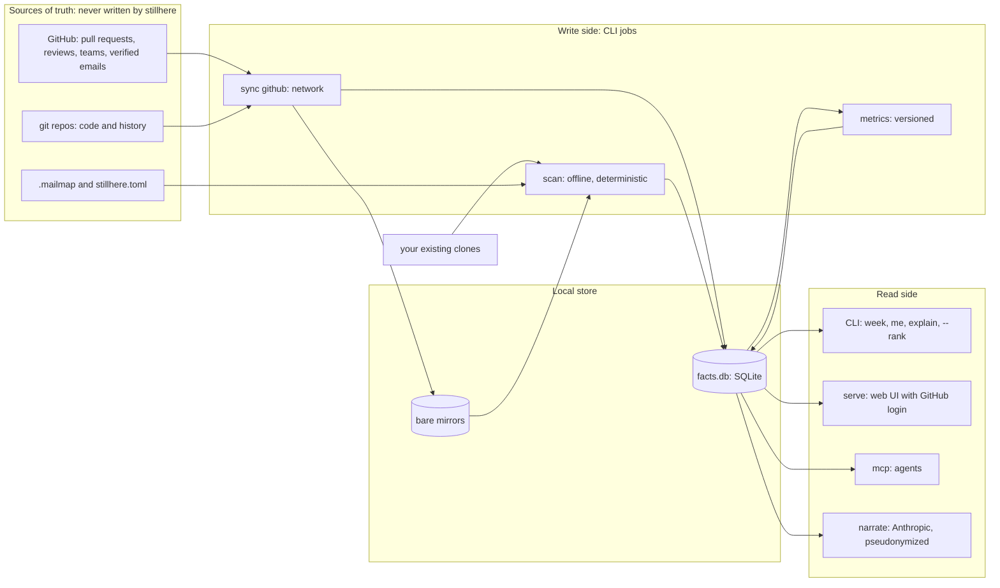

# Architecture

Status: draft v2 · 2026-10-14 · decisions in [adr/](adr/), implementation contracts in [spec/](spec/)

## Shape

stillhere is one Go binary. CLI jobs write facts; the CLI, the web server, and the MCP server read them. Only `sync` touches the network for data. `narrate` calls Anthropic, and only when asked.

This is CQRS in its simplest form: jobs that write facts are separate from the services that read them. The read side never mutates facts, so a bug in the web server cannot corrupt measurements.

## Bounded contexts

| Context | Vocabulary | Facts it writes | It is not |
|---|---|---|---|
| Sources | repo, group, mirror, default branch | repos, heads | A forge inventory |
| History | commit, landing, trailer | commits, landings, landing_commits, commit_files, trailers | Ownership |
| Authorship | line owner, majority owner | line_owners (per run) | Activity |
| Forge | pull request, review, team | prs, pr_commits, reviews, review_comments, logins | Git facts |
| Identity | person, alias, login link | people, login_links (both derived) | A people database |
| Metrics | metric@version, scope, window | metric_values, rank_intervals | Facts |
| Presentation | page, highlight, tool | Nothing (read-only) | Measurement |
| Narration | comment | narrations | A measurement |

A context's facts are written by its own collector only. The Forge context translates GitHub's model into our facts through an anti-corruption layer, so GitHub field names never leak into metrics.

## Data ownership

| Data | System of record | Writes it | Reads it | How it crosses into stillhere | Consistency readers need |
|---|---|---|---|---|---|
| Code, history, default branch | Each git repo (GitHub is origin) | Developers, via git | `scan`, through the git CLI | `sync` fetches mirrors; or your own clones as they are | Snapshot at the recorded HEAD SHAs |
| Pull requests, reviews, comments, labels | GitHub | People on GitHub | `sync` | GraphQL, incremental by `updated_at`, upsert by node ID | As of the last sync watermark, shown on every page |
| Who is a lead | A GitHub org team | Org admins | `serve`, at login | The user's token at sign-in, re-checked hourly | Fresh within an hour |
| A user's verified emails | GitHub | The user | `serve`, at login | The user's token at sign-in; not stored | Fresh at sign-in |
| Email aliases | `.mailmap` in each repo, plus an org mailmap file | Users, in reviewed files | git itself (`-c mailmap.file=`) | Applied by git during scan | Same run |
| GitHub login ↔ email | GitHub commit-author associations | GitHub | `sync` | Derived facts with provenance | As of last sync |
| Noise rules, bot and AI patterns, thresholds | `stillhere.toml` (or the packaged default) | The user | Collectors and metrics | File; SHA-256 recorded per run | Same run |
| Metric definitions | stillhere source, versioned | Contributors, through review | Metrics | Code | Cited per value |
| Facts, metric values, narrations | facts.db (derived, disposable) | stillhere jobs | All read-side adapters | Local file | Readers see complete runs only |

stillhere creates no second owner of any fact. Identity in particular stays with `.mailmap` (aliases) and GitHub (logins, verified emails). There is no hand-maintained people table that would drift from either.

## Commands

| Side | Command | Network | Writes |
|---|---|---|---|
| Write | `sync github` | GitHub API, git fetch | mirrors, forge facts |
| Write | `scan` (later `backfill ownership`) | None | a run: history, authorship facts, metric values |
| Analysis | `week` | None | Nothing: it prints what landed |
| Read | `report`, `me`, `explain`, `who-knows`, `validate`, `metrics` | None | Nothing |
| Read | `serve` | GitHub at sign-in | Sessions, audit log |
| Read | `mcp` | None (stdio) | Nothing |
| Read | `narrate` | Anthropic API | narrations |

## Ports and adapters

| Port | v1 adapter | Later |
|---|---|---|
| GitRunner | `git` subprocess with an *analysis* profile (offline, hardened) and a *sync* profile (network, credentials supplied per command) | In-process git if blame time is ever dominated by process start |
| ForgeSource | GitHub GraphQL and REST | GitLab |
| FactStore | SQLite via `modernc.org/sqlite` (no CGO, so the binary stays static) | Postgres for a large team server |
| Authenticator | GitHub App user sign-in | Trusted identity headers from a proxy (oauth2-proxy, Cloudflare Access) |
| Narrator | Anthropic Messages API via `anthropic-sdk-go` | |
| Inbound | CLI, HTTP server (`net/http`, `html/template`, `embed`), MCP server (official Go SDK) | Remote MCP over HTTP, with auth |

The core (classification, metrics, ranking) imports no adapter package: no `os/exec`, no `net/http`, no SQL driver. depguard enforces this in CI. Tests run the core against facts directly, and run adapters against real git, recorded GitHub responses, and a temporary SQLite file. The package map, the dependency rule and the signatures between packages are in [spec/codebase.md](spec/codebase.md).

## Storage

`facts.db` holds runs. Each run is a snapshot (details and the Go contracts in [spec/codebase.md](spec/codebase.md#run-model)):

- **runs**: run id, `--now`, tool version, policy hash, the HEAD of every repo, the forge sync watermark, and a status. A run is written as `running` and flips to `complete` (or `partial`) after its last row; readers select only complete and partial runs, so nobody sees half a run. WAL mode lets reads continue while a run writes.
- **Git-derived facts are per run**: commits, landings, the landing map, file changes, reverts, path classes and line owners. The mailmap and the policy can change between runs, and every number in a run must come from one HEAD set, one policy and one mailmap. A force-push simply shows up in the next run's history. The cost is repeated rows across runs, bounded by retention.
- **line_owners** are aggregated as (repo, path, commit, author, non-blank lines). That is roughly one row per file per contributing commit: about 250,000 rows for a 50,000-file organization.
- **Forge facts** are not per run: they replicate GitHub, upserted by node id with a watermark per repo, and each run records the watermark it read.
- **Retention**: when a run finishes, the newest 8 runs plus the newest run of each of the 12 most recent months that have one, per kind (restic's `--keep-last 8 --keep-monthly 12`); configurable later.
- **metric_values** and **rank_intervals** carry `metric@version`, scope, window and run id, so a new metric version can be computed over old facts and shown next to the old one.

`report.json` is an export of one run, the published language for tools that do not want SQL. Its draft shape is in [spec/report-json.md](spec/report-json.md).

## Reliability

- **Bulkheads**: one repo, or one repo's GitHub sync, failing is recorded on that repo and the run continues. A run with failures is marked `partial`, and pages say so.
- **Idempotent, resumable sync**: upserts keyed by GitHub node ID, a watermark per repo, and resuming after a crash or a rate limit. GraphQL allows 5,000 points per hour; requests run with bounded concurrency to stay under GitHub's secondary limits.
- **Determinism**: an explicit `--now`, seeded bootstrap, stable sort orders. A CI test runs the fixture twice and compares the bytes.
- **One version floor, git 2.44**: it brings `GIT_NO_LAZY_FETCH` (the no-network guarantee) and also covers `check-attr --source` (2.40, needed to read attributes at the scanned revision and in bare mirrors) and `--diff-merges` (2.31). Older git exits with a usage error. See [spec/git-invocation.md](spec/git-invocation.md#version-floors).
- **Oracles**: synthetic fixture repos with hand-derived expected values for every metric version ([testdata/fixture/SPEC.md](../testdata/fixture/SPEC.md)), plus recorded GitHub API responses for sync.
- **Budgets**: a cold scan of 100 repos and 50,000 files in under 15 minutes on 8 cores; `week` in under 60 seconds; web pages under 300 ms at p95.

## Security and privacy

| Threat | Mitigation |
|---|---|
| A token leaks into a remote URL, log, report or page | Credentials are supplied per git command, never written to config or URLs. Userinfo is scrubbed from every stored or printed URL. A test greps every output for a planted token. |
| A hostile repo runs code when git is invoked | Hooks, fsmonitor and external diff are disabled; global config is ignored. Residual risk: a repo's textconv or smudge filters. stillhere is not a sandbox for untrusted repos. |
| Script injection through author names | `html/template` escapes by context (text, attribute, URL, JavaScript). Names are treated as untrusted; the fixture includes `Frank & Sons`. |
| Session theft or forged sign-in | GitHub App sign-in with a state parameter; signed `HttpOnly`, `Secure`, `SameSite=Lax` cookies with a short lifetime; TLS required in front of the server. |
| Someone sees ranks they should not | Deny by default. Leads (a named GitHub team) see ranks; each person sees their own page; org members see highlights and code-area views. An audit log records who opened ranked views. |
| Personal data exposure | Emails are never rendered. `facts.db` and mirrors are created with mode 0600/0700 and documented as sensitive. Retention limits apply. |
| The narrator leaks identities or code | Placeholders replace people (names restored locally); no emails, source, commit subjects or absolute paths are sent; every number in the reply must appear in the payload. |
| An agent reads source it should not | MCP is local stdio; diffs are exposed only with `--allow-source`. |

GitHub App permissions (read-only): repository contents, pull requests and metadata; organization members; account email addresses. An org admin installs the app once.

## Deployment

- **Laptop**: `brew install`, or download the binary. Point it at your clones or let `sync github` manage mirrors.
- **Team server**: one container image (the stillhere binary plus git 2.44 or newer) with a volume for mirrors and `facts.db`, GitHub App credentials in the environment, and TLS terminated in front. How refresh is triggered is open decision 4 in [product.md](product.md#open-decisions).
- **Later**: a scheduled GitHub Action that runs `sync` and `scan` and uploads the run.

## Patterns and further reading

- CQRS (write jobs and read services): Martin Fowler, "CQRS" (bliki).
- Ports and adapters: Alistair Cockburn, "Hexagonal Architecture".
- Bounded context, anti-corruption layer, published language: Eric Evans, *Domain-Driven Design*.
- Bulkheads: Michael Nygard, *Release It!*
- Metrics as code (versioned, reviewed, tested definitions): Airbnb's Minerva, "How Airbnb Achieved Metric Consistency at Scale".
- SQLite as the store: "SQLite As An Application File Format" (sqlite.org).
- Code survival: Erik Bernhardsson, "The half-life of code & the ship of Theseus".
- Hotspots and knowledge loss: Adam Tornhill, *Your Code as a Crime Scene*.
